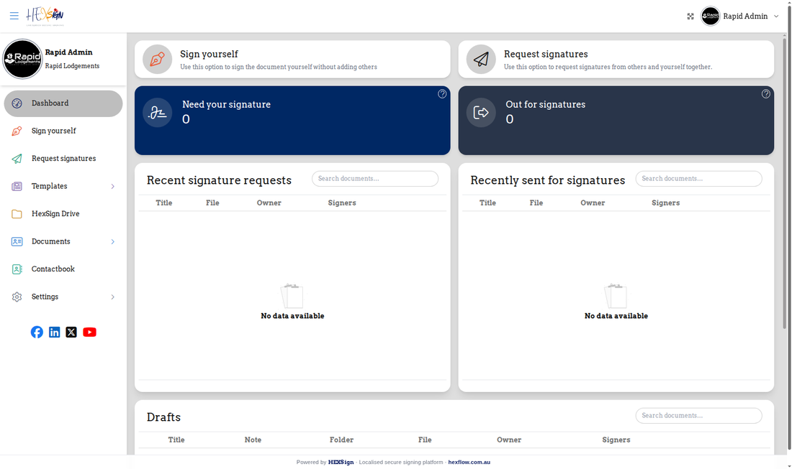
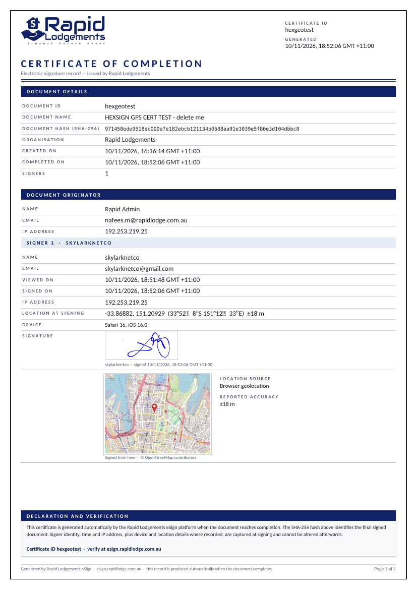
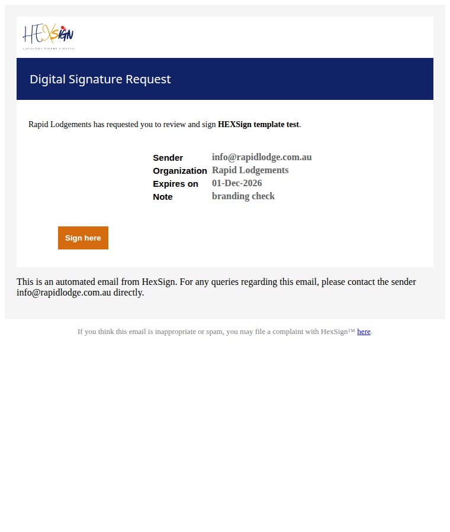

# HEXSign — white-label e-signing platform

A complete **branding + operations overlay** for a self-hosted [OpenSign](https://github.com/OpenSignLabs/OpenSign)
instance: your name, logo, font and footer across the platform, your identity in every email and on every
completion certificate, mandatory GPS capture at signing, and scripts that stop a container rebuild from
wiping any of it.

Live reference deployment: `https://esign.rapidlodge.com.au` (Rapid Lodgements / Hex Flow).

| Login | Dashboard |
|---|---|
|  |  |

| Completion certificate — GPS block + map | Signature-request email |
|---|---|
|  |  |

---

## What it does

- **SPA rebrand** — page title, logo, favicon/app icons, manifest, 8 locales, 140+ strings
- **Arvo typography** — self-hosted woff2 (no Google Fonts call); Font Awesome deliberately untouched
- **Footer bar** — "Powered by … · … · yoursite.com", hidden when printing
- **Coloured icons** — per-item sidebar colours, true brand colours on the social row
- **Emails** — all three senders (request, batch, system) carry your logo, footer and complaint address;
  zero vendor branding anywhere
- **Certificate** — your logo, navy layout, GPS coordinates, accuracy, OpenStreetMap thumbnail with pin,
  SHA-256, audit trail, `Digitally signed by …` signature block
- **GPS gate** — blocking location card on signing links only, never on the login page
- **Operations** — `apply.sh` (deploy + verify), `ensure.sh` (self-heal), `verify.sh` (20 live checks),
  nightly database and document-file backups

---

## Quick start

```bash
git clone <this repo> hexsign && cd hexsign
./scripts/apply.sh       # deploy to your containers, restart the API, verify
```

Standing up the upstream OpenSign stack first, plus the full checklist: **[docs/INSTALL.md](docs/INSTALL.md)**.

---

## Repository layout

```
client/client-build.tar.gz      branded SPA build (drop-in for /usr/src/app/build)
server/                         branded server files: Utils.js, 3 mail senders, PDF + certificate engine, logos
deploy/opensign-stack.yml       recorded stack shape (images, ports, network, volume names)
deploy/opensign.env.example     every required environment variable, values left blank
scripts/apply.sh                deploy overlay -> containers (syntax gate, backup, restart, verify)
scripts/ensure.sh               drift guard — re-applies branding if a rebuild wipes it (cron */15)
scripts/verify.sh               20 live checks: health, title, logo, fonts, footer, GPS gate, no vendor strings
scripts/backup-db.sh            mongodump of the database, 14-day retention
scripts/backup-files.sh         document PDFs + certificates, 7-day retention
docs/BRANDING.md                exactly what changed, file by file
docs/INSTALL.md                 install on your own server, end to end
docs/RUNBOOK.md                 day-2 operations, rollback, restore
```

---

## Why this repo exists

The platform runs from stock `opensign-server` / `opensign-client` images with **no volumes for code**.
Any `docker compose up --build`, image pull or container recreate reverts the site to upstream OpenSign
(OpenSign logo, "OpenSign" wording, no Arvo, no footer, GPS gate on the login page).
`scripts/apply.sh` restores the branded state; `scripts/ensure.sh` (cron) does it automatically within
15 minutes.

## Tenant email templates

The signature-request and completion emails live in the database, per tenant.
Shipped defaults are in `deploy/tenant/`, applied with
`./scripts/apply-tenant-templates.sh` — see [docs/TENANT-TEMPLATES.md](docs/TENANT-TEMPLATES.md).

## Cloud drive mirror (optional)

Mirror stored documents into a Google Drive / Shared drive as a compose sidecar or a
systemd service — service-account credentials, one-way and additive.
Setup: [docs/DRIVE.md](docs/DRIVE.md)

## Branding policy — the platform is ours

HEXSign is our product. Deploying it gives you the platform **as branded**, not a white-label kit:

- The product name, wordmark, logos, Arvo treatment, footer, icon colours, email and certificate
  layouts are **fixed** and may not be removed, replaced or rebranded. See [LICENSE](LICENSE).
- What you **can** customise is tenant-level, inside the app: your organisation name, your tenant
  logo, your signer-facing message templates, your users and roles. That is what makes the
  deployment yours without changing the product.
- Redistribution, resale or presenting the platform under another name is not permitted.

There is deliberately **no rebrand script** in this repository.

## Apply / repair

```bash
./scripts/verify.sh      # is the live platform correct?
./scripts/apply.sh       # (re)deploy the branding, restarts opensign-server, verifies
./scripts/ensure.sh      # non-destructive drift check; applies only if needed
```

Installed cron:

```
*/15 * * * *  /home/superuser/hexsign/scripts/ensure.sh        # self-heal after any rebuild
30 2 * * *    /home/superuser/hexsign/scripts/backup-db.sh     # nightly database dump
0  3 * * *    /home/superuser/hexsign/scripts/backup-files.sh  # nightly document archive
```

## After any image update

```bash
docker compose pull && docker compose up -d   # or however the stack is updated
/home/superuser/hexsign/scripts/apply.sh      # re-apply branding (ensure.sh would do it within 15 min)
/home/superuser/hexsign/scripts/verify.sh
```

## Infrastructure reality (important)

- The containers were created with `docker run`, not compose. `deploy/opensign-stack.yml` records the real
  shape (images, ports, network `opensign-stack_opensign-net`, volume names) so the stack is rebuildable.
  Secrets are **not** in git — they live in `/home/superuser/.hermes/private/opensign.env` (mode 600).
- **`/usr/src/app/files` (all signed PDFs + certificates, ~70 MB, 142 files) is inside the `opensign-server`
  container, not on a volume.** Recreating that container would destroy them. Mitigation in place: nightly
  archive (`scripts/backup-files.sh`, 03:00, 7-day retention). Proper fix = migrate to a named volume,
  which needs one container recreate.
- `esign.rapidlodge.com.au` is routed by Caddy config stored in the `caddy-config` volume (API-written, not
  the on-disk Caddyfile). Back it up before touching Caddy.

## Backups

| What | When | Where | Retention |
|---|---|---|---|
| Mongo database | 02:30 daily | `/home/superuser/esign-backups/opensign_*.gz` | 14 days |
| Document files (PDFs) | 03:00 daily | `/home/superuser/esign-backups/files/esign-files_*.tgz` | 7 days |
| Container env/secrets | on demand | `~/.hermes/private/opensign.env` (600) | — |

## Rules

- Never edit files directly inside the containers and leave them there — change the repo, then `apply.sh`.
- `apply.sh` never deletes data: it only replaces code, keeps a pre-apply backup in
  `/home/superuser/esign-patches/apply-<stamp>/` and leaves the previous build as
  `/usr/src/app/build.previous` inside the client container.
- Emails already sent cannot be rebranded retroactively.

## Licence / provenance

The HEXSign branding, overlay, scripts and documentation are the property of Hex Flow — all rights
reserved, see [LICENSE](LICENSE). The application underneath is OpenSign, licensed by OpenSign Labs.
