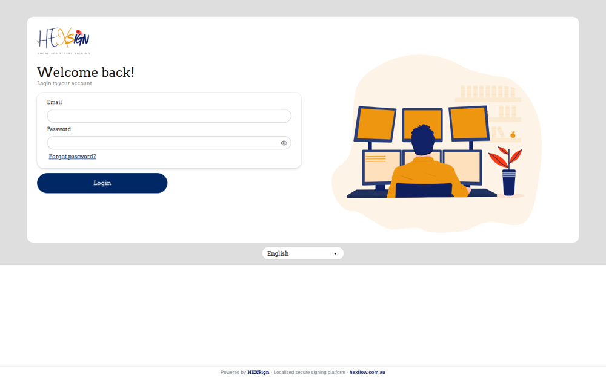
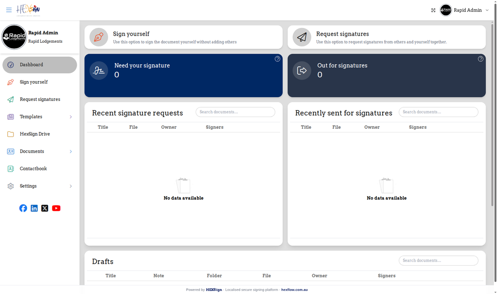
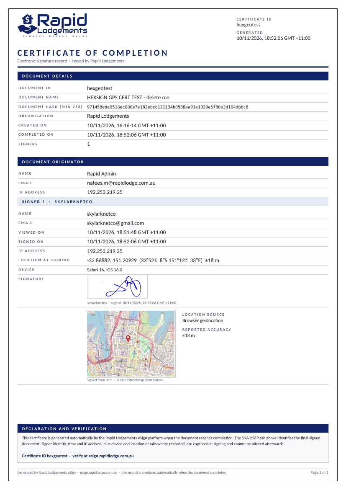
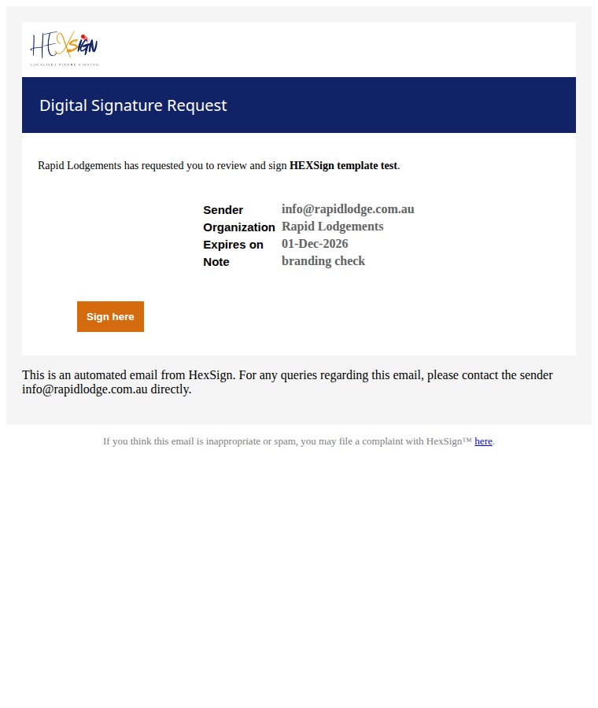

# Installing HEXSign on your own server

This overlay turns a stock [OpenSign](https://github.com/OpenSignLabs/OpenSign) deployment into a
white-labelled signing platform: your brand in the UI, your logo in the emails, your name on the
certificate, Arvo typography, a footer with your website, and GPS location capture that only appears
on signing links.

Everything below has been run against a live instance. Nothing here contains secrets.

---

## 0. What you get

| | |
|---|---|
|  |  |
| Login — your brand, your logo, your font | Dashboard — coloured icon set, footer with your site |
|  |  |
| Certificate — audit record with GPS map + signature block | Signature-request email — your logo, no vendor branding |

---

## 1. Prerequisites

- A Linux server with Docker and Docker Compose v2
- A domain + reverse proxy (Caddy, nginx, Traefik) with TLS
- Outbound SMTP credentials (Gmail app password, SES, Mailgun, …)
- **A signing certificate** (`.p12` / `.pfx`) — base64 it for `PFX_BASE64`, and its passphrase for `PASS_PHRASE`.
  OpenSign needs one to sign the completion certificates. Without it the platform still runs but
  cannot produce signed certificates.

---

## 2. Bring up the upstream stack first

This repo is an **overlay** — it does not ship the OpenSign application itself. Start the stock stack
first. `deploy/opensign-stack.yml` defaults to the public images `opensign/opensignserver:main` and
`opensign/opensign:main`; override `OPENSIGN_SERVER_IMAGE` / `OPENSIGN_CLIENT_IMAGE` if you run your own
build (see `deploy/docker/` for reference Dockerfiles):

```bash
cp deploy/opensign.env.example deploy/opensign.env   # fill in your values (gitignored)
docker compose -f deploy/opensign-stack.yml up -d
```

Required environment (see `deploy/opensign.env.example` for the full list):

| Variable | Meaning |
|---|---|
| `APP_ID` | Parse application id (any string, e.g. `opensign`) |
| `MASTER_KEY` | Parse master key — long random string |
| `MONGODB_URI` | e.g. `mongodb://opensign-mongo:27017/opensign` |
| `SERVER_URL` | `http://opensign-server:8080/app` |
| `PUBLIC_URL` | `https://sign.example.com` |
| `SMTP_*` | host, port, secure, username, password, from-address |
| `PFX_BASE64`, `PASS_PHRASE` | signing certificate + passphrase |

Check it works before branding anything:

```bash
docker ps --format '{{.Names}}' | grep opensign     # opensign-server, -client, -mongo, -mailpit
curl -s https://sign.example.com/api/app/health     # expect 200
```

Container names are pinned in the compose file (`container_name: opensign-server`, …), so the scripts in
this repo address the right containers without edits.

---

## 3. Apply the branding

```bash
git clone <this repo> hexsign && cd hexsign
./scripts/apply.sh       # deploys the client build + server patches, restarts the API, verifies
```

`apply.sh` will:

1. syntax-check every server file **before** touching the container (aborts on any error),
2. archive what it replaces into `/home/superuser/esign-patches/apply-<stamp>/`,
3. extract the branded SPA build (atomic directory swap; the previous build is kept as `build.previous`),
4. restart `opensign-server`, wait for `/api/app/health` = 200,
5. run `scripts/verify.sh` — 20 checks; a failure is loud.

If anything goes wrong: restore the `apply-<stamp>` directory or `build.previous`, or simply re-run
`apply.sh`.

The branding is the product: it is not configurable, and there is no rebrand step by design (see
[LICENSE](../LICENSE)).

## 4. Your own admin, tenant and logo

The platform identity stays HEXSign. What is yours is the **tenant**:

1. Open `https://sign.example.com` and sign up — the **first account becomes the admin**.
2. In **Settings → Tenants**, your tenant is created automatically with the admin as owner.
3. Set the tenant **name**, **logo** (upload your mark — this is what appears in the app header and on
   the certificate), **request subject/body templates**, and your team members.
4. The tenant logo you upload appears in the app header and on the certificate PDF; replace
   `server/images/logo.png` only if you need a different certificate logo file.

Tenant name, logo, templates and users are database records — per installation, never in this repo.

---

## 5. What the branding overlay changes

See [`BRANDING.md`](BRANDING.md) for the file-by-file list. In short:

- SPA build: page title, logo, favicon/app icons, Arvo webfont (self-hosted), footer bar,
  coloured sidebar icons, GPS card scoped to `/load/recipientSignPdf/…` only
- Server: `appName`, certificate signature reason/name/contact, spam-report footer in all three mail
  senders, certificate logo, map tile user-agent, DOCX error text, removed call-home to the vendor API

---

## 6. Operating it

```
*/15 * * * *  /path/hexsign/scripts/ensure.sh        # re-applies branding if the image is ever rebuilt
30 2  * * *   /path/hexsign/scripts/backup-db.sh      # mongodump, 14 days
0  3  * * *   /path/hexsign/scripts/backup-files.sh   # document PDFs, 7 days
```

Read [`RUNBOOK.md`](RUNBOOK.md) before making changes, and note the two infrastructure warnings there
(document files must be moved onto a volume; back up the reverse-proxy config).

---

## 7. Requirements checklist

- [x] Docker host + compose v2
- [x] Domain with TLS
- [x] SMTP credentials
- [x] Signing certificate (.p12) for certificates
- [x] MongoDB (via compose)
- [x] Reverse proxy route to the app
- [x] This overlay for the branding
- [ ] Your organisation's logo for the tenant profile (uploaded in-app)

Everything else the platform needs — application images, database, branding build, fonts, icons,
scripts, stack definition and environment contract — is either public upstream or in this repository.

## 7. Tenant email templates

Apply the shipped signature-request and completion emails to your tenant:

```bash
./scripts/apply-tenant-templates.sh
```

They are tenant data — replace the signature block, phone numbers and logos with your own.
Details: [TENANT-TEMPLATES.md](TENANT-TEMPLATES.md)
